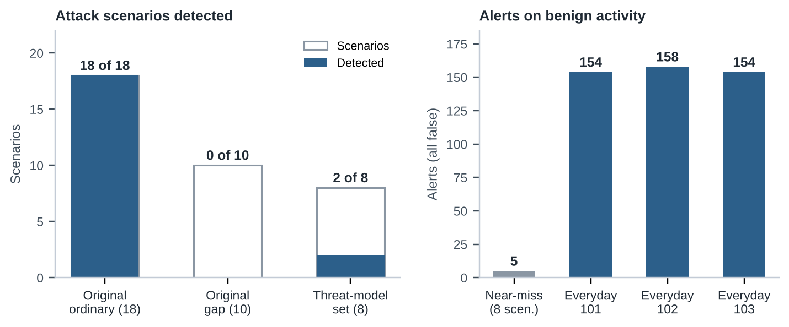
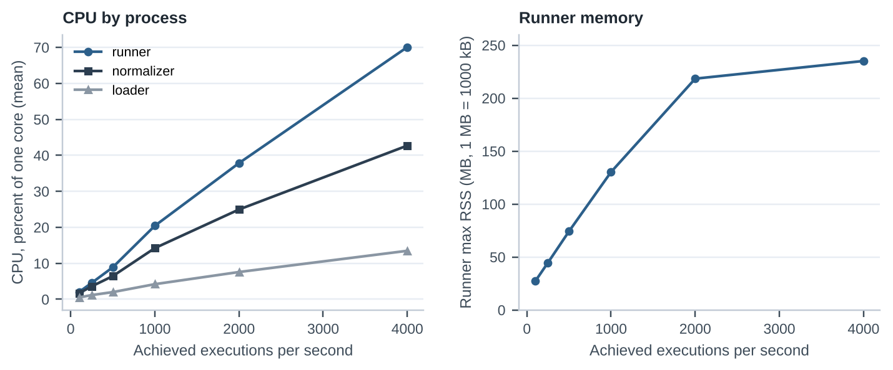

# An eBPF Endpoint Detection Engine: Ten Behavioral Detectors, Measured Results, and Failures

**Author:** Andrew Gruenewald, Computer Science - Cybersecurity, November 2026
**Project:** eBPF Endpoint Detection Engine, https://github.com/andrew04-cybersec/eBPF-Endpoint-Detection-Engine
**Code state described:** HEAD `96e74cc0d186c4aa8118ba0bc7b5bb938723dafe` (2026-10-31)

---

## 1. Abstract

I built a Linux endpoint detection engine that watches process, file, network, and privilege behavior through eBPF tracepoints and raises alerts with ten behavioral detectors that emit eleven alert names, each mapped to a MITRE ATT&CK technique. A C loader feeds a Python pipeline that builds a process graph and applies the detectors, and I evaluated the result on one WSL2 machine with frozen predictions, attack scenarios, benign near-miss scenarios, three one-hour developer workloads, and a stepped stress test. The detectors fired on all 18 ordinary attack scenarios I wrote and on none of the 10 scenarios I built to evade them, and they detected 2 of 8 scenarios in a second, threat-model set that the repository describes as drafted from threat models and not from detector logic. Eight benign near-miss scenarios produced five false alerts, as I predicted, and the developer workloads produced 466 false alerts in three hours, about 155.33 per hour, 463 of them from the burst rule `rapid_spawn` firing on `make -j4` builds, against a frozen prediction of none. The stress test reached about 4,000 process executions per second with no ring-buffer loss counted by the loader, using up to 70 percent of one core in the Python runner, although a zero loss count is not a claim of complete coverage. I never measured the system's overhead against a baseline, and I could not establish the cause of six of the misses beyond hypotheses built from events and code.

---

## 2. Introduction

A host-based detector sees only what its sensors record, and decides only what its rules can express. I wanted to learn how far a small system built on those two ideas gets on a single Linux machine, and to learn it by measurement and not by argument. My previous project, a ptrace-based syscall tracer, showed me what the syscall boundary reveals about a process and where it stops being useful. This project takes the next step, replacing the tracer with kernel telemetry that is cheap enough to leave running, and adding the stateful logic that turns raw events into judgments.

The engine has three goals. It should observe process creation and exit, file opens on sensitive paths, outbound connections, and privilege changes with eBPF. It should reconstruct who started what, so that a detector can reason about ancestry and not only about a single event. And it should alert on a small number of behaviors that attackers commonly show, with every alert carrying an ATT&CK technique. It does not block or kill anything, it covers one host and one platform, and it is not a product. I wrote it in under six days (58 commits), and this paper describes the code at the commit named above.

The part I care about most is the evaluation. I froze predictions in Git before each run, kept scoring rules fixed, and preserved results that do not favor the engine. Most of the paper's numbers are therefore less flattering than the ones the engine produced on the scenarios I designed myself, and I explain why in Section 5.

---

## 3. System architecture

The engine is a pipeline of separate processes connected by pipes that carry one JSON line per record, shown in Figure 1. A privileged C loader attaches the kernel programs and prints each ring-buffer record as JSON. A Python normalizer reads those lines, assigns every process a stable key, and joins each exec attempt to its result. A Python runner builds the process graph, hands each normalized event to the ten detectors in order, and passes any alert to a sink that writes it as a JSON line and as a readable block. For evaluation I wrap the same stages with two `tee` stages that save the raw and normalized streams and a stamper that records when each alert arrives, which makes six stages in all.

{width=100%}

Separate processes mean that a failure in a later stage never stops the kernel programs, and every stage can be replayed from a saved file, which is how I rescored saved runs after changing the harness. Three design choices shape the rest of the paper. The engine attaches to named syscall and scheduler tracepoints and not to kernel function probes, because tracepoints are defined instrumentation points [3], at the cost of depending on kernels that define them. It observes and alerts only. And detectors judge single events while a shared graph supplies ancestry, so every rule can be tested on constructed event streams without a kernel.

---

## 4. Implementation

### 4.1 Kernel telemetry

The kernel object is a C program built with libbpf and CO-RE, so that field offsets are relocated at load time and the compiled object is portable across kernel builds that expose the needed BTF information [4]. It holds twelve tracepoint programs and five maps. Eleven of the twelve load by default, because the entry variant of the file-open hook loads only when the loader is started with `-e`. The programs record seven kinds of record: exec attempts and successes, exits, file opens, outbound connects, privilege changes, and a `lost` record that reports dropped events. Records go to a 4 MiB ring buffer, a shared buffer from which user space reads [2].

Two choices matter later. First, file opens are filtered in the kernel: only an open of a sensitive path (`/etc/shadow`, `/etc/passwd`, `/etc/sudoers`, SSH key directories) or an open with write intent on a persistence path is reported, because a record for every open would be too costly. The filter limits output and not the probe's cost, which is paid on every open. Second, the open hook reads the path at syscall exit and not at entry. At entry, 95 of 3,094 observed opens had a blank path in my telemetry test, against none at exit, and I do not know why the entry read fails. Capture caps apply to arguments (16 arguments of 128 bytes each), and a record that hits one is flagged as truncated.

The sensors cannot see everything. Nothing hooks `rename`, `creat`, `link`, or `symlink`, connects over anything but IPv4 and IPv6 are not recorded, environment variables are never read, and `io_uring` based operations are untested, a gap whose real-world importance public vendors dispute [6, 7]. These blind spots explain several results in Section 7.

### 4.2 Normalization and the process graph

The normalizer keys every process as `pid:start_time_ns`, because process ids are reused and a bare pid cannot identify a process over a long run. It joins each exec attempt to the success that follows it, derives a failed exec when none arrives, and counts anything it cannot place.

The runner's graph keeps one node per process and links each to its parent. When a process's parent was never seen, which is the usual case for anything started before the loader, the graph creates a placeholder node, so a detector can see that its ancestry is incomplete and decline to judge instead of guessing. Ancestry queries stop for one of seven recorded reasons, such as reaching init or hitting the depth cap of 64. The graph holds at most 100,000 nodes and every limit of this kind is a first guess that I did not tune.

### 4.3 Detectors and ATT&CK mapping

Table 1 summarizes the ten registered detectors. Each is a Python function that receives the graph, one event, and shared state, and returns one alert or nothing. The persistence detector raises two alert names, `persistence_write` for a write-intent open of a persistence path and `persistence_command` for installing a cron table or enabling a unit, which is why ten detectors give eleven alert names.

| Detector | What it looks for | ATT&CK label |
|---|---|---|
| `shell_from_service` | a shell whose parent is a named service, such as `nginx` | T1059.004, direct |
| `exec_from_tmp` | an executable run from `/tmp`, `/var/tmp`, or `/dev/shm` | T1059, weak |
| `download_chmod_exec` | `curl` or `wget` output made executable, then run, within 600 s | T1105, direct |
| `unusual_ancestry` | a shell, interpreter, or network tool with a service ancestor | T1059, partial |
| `sensitive_file_access` | a successful open of shadow, sudoers, or SSH key files by a program not on a 26-name reader list | T1003.008 and T1552.004, direct |
| `rapid_spawn` | 25 or more distinct children of one parent within 2 s | T1059, weak |
| `outbound_after_exec` | a non-loopback connect within 60 s of an exec of a shell, interpreter, or `/tmp` program | T1095, partial |
| `persistence` | a write-intent open of a persistence path, or an exec that installs a cron table or enables a unit | ten techniques |
| `privilege_escalation` | a request for uid 0 by a program not on a 22-name list, or a process appearing at uid 0 after a nonzero uid | T1068, partial |
| `interpreter_chain` | a chain of at least three watched shells or interpreters of two families with an inline-code option | T1059, direct |

*Table 1. The ten detectors, as implemented. The name lists, windows, and thresholds are first guesses.*

One detail changes how results read. Suppression and service identification use `comm`, the name of the file that was run, so a copy of an attacker's tool named `sudo` inherits the trust that `sudo` has.

Every alert carries one ATT&CK technique chosen by a lookup table, and the table also assigns each technique a confidence label (direct, partial, or weak). The mapping is a design choice that I made and verified against the ATT&CK site, not a measurement [8], and the confidence labels live in the table and are not written to alerts. Choosing one technique per detector is lossy: T1059 stands for four different detectors with three different confidence levels, so anyone grouping alerts by technique would merge rules with very different false-positive behavior.

---

## 5. Evaluation methodology

I used five recorded sets, all on one machine under WSL2 (kernel `6.6.87.2-microsoft-standard-WSL2` [5], Ubuntu 24.04), summarized in Table 2.

| Set | Contents | Purpose |
|---|---|---|
| Original | 28 attack scenarios (18 ordinary, 10 built to evade) and one benign smoke scenario | recall and precision on scenarios I wrote |
| Threat-model set | 8 attack scenarios (S30 to S37) | recall on scenarios drafted from threat models |
| Near-miss | 8 benign scenarios built to resemble attacks | false positives on edge cases |
| Everyday | one scripted developer workload, run three times for one hour each | false positives per hour |
| Stress | six steps from 100 to 4,000 spawns per second | throughput, loss, and resource use |

*Table 2. The evaluation sets. Each attack and benign set was frozen in Git with predictions before its run.*

**Scenarios and scoring.** A scenario is a script with a setup step that runs before recording, an action that runs in a recorded window, and a teardown. Each attack lists the detections it expects, and a scenario counts as detected only if every expected detection fires inside its window; an alert for the wrong detection does not count. Alerts in a benign scenario are false positives by definition. The predictions for every scenario were written and committed before the run that scored them.

**What the groups mean.** The 18 ordinary scenarios were written by me after reading the detection rules, so their recall is a best case and not a detection rate. The 10 gap scenarios were built to evade documented limits, and a miss is the expected result. The threat-model set is the more informative one: the repository describes it as drafted from threat models and not from detector logic, and every scenario is labeled `detected` because that is what a competent detector should do. I did not establish who drafted it, what they had read, or that they were isolated from the detector logic, so I treat its result as a second measurement that is less tied to my own rules and not as an independent test. The near-miss set contains actions such as an install staged in `/tmp`, a parallel build, and a `cat` of a private key, and the everyday set is a long scripted run of developer commands with a frozen prediction of no alerts.

**Harness.** A privileged driver starts the pipeline, runs the scenarios with a pause after each, samples CPU and memory every second, reads per-program `bpf_stats`, and stamps each alert's arrival so that latency is the arrival time minus the triggering event's kernel timestamp. After the first run I changed the harness to attribute benign alerts by time window; rescoring five saved runs with the old and new code gave byte-identical score files, so no earlier score changed.

---

## 6. Results

### 6.1 Detection

Table 3 gives the detection and false-positive outcomes.

| Set | Result | Alerts |
|---|---|---|
| Original, ordinary group | 18 of 18 detected | 21 alerts in total across the original set, none false |
| Original, gap group | 0 of 10 detected | as predicted |
| Threat-model set | 2 of 8 detected (S33, S36) | 3 alerts, none false; 6 of 8 predictions failed |
| Near-miss | 5 false alerts, 3 clean | all 8 predictions matched |
| Everyday, runs 1 to 3 | 154, 158, and 154 false alerts | 466 in 3.000 h, 155.33 per hour |

*Table 3. Detection and false-positive results. All 29 original predictions matched.*

In the original set the 18 of 18 and the 0 of 10 were both predicted, so the set mostly confirms that the scenarios behave as their author understood them. Pooled over the 28 attack scenarios, 18 were detected (0.643) and all 21 alerts were true. Precision of 1.000 says little, because a set with no benign look-alikes cannot produce a false positive.

The threat-model set is the result I weigh most. S33 (a private key read) and S36 (a shell startup file write) were detected, and the other six were missed, so six of eight predictions failed. In S35 the persistence rule alerted on the cron file write, but the scenario also expects `persistence_command`, no `crontab` command was run, and the frozen rule scores it as a miss. I kept it as a miss. The author of the set calls that double expectation a labeling choice for me to review, and a reader who disagrees would count the recall differently, but I did not retune any label after the fact.

{width=100%}

### 6.2 False positives

All five near-miss false alerts were predicted: `exec_from_tmp` on an install staged in `/tmp`, `rapid_spawn` on `make -j200`, `persistence_write` on appending a line to `.bashrc`, and `sensitive_file_access` on `cat` of a private key and on root `cat /etc/shadow`. Three scenarios stayed clean, and two of them stayed clean for reasons that point to weaknesses (Section 7).

The developer workload was the clearest failure. I froze a prediction of no alerts, because the workload is ordinary commands. It produced 154, 158, and 154 alerts in three one-hour runs, which is 155.33 per hour pooled, or about one alert every 23 seconds. Of the 466 alerts, 463 were `rapid_spawn`: a `gcc` compile whose parent is `make -j4`, one alert per `make` process. The remaining three were the machine's own hourly `cron` job opening `/etc/shadow`, which is not on the reader list. Eight of the ten detectors raised nothing in three hours, which is favorable, but some of that silence is a lack of judgment: in one run 1,361 `/etc/passwd` opens could not be evaluated by the second file-access tier. I did not predict the alert rate and I did not measure other threshold values.

### 6.3 Latency, throughput, and resources

Latency, from the kernel timestamp of the triggering event to the alert's arrival at the harness, was about a millisecond at the median in every run (0.43 to 1.32 ms). The tail is longer: the 95th percentile ranged from 0.60 ms to 21 ms and the maximum was 80 ms in the original run and 83 ms in the first everyday run. The pipes were buffered, I did not measure unbuffered mode, and the cause of the tail is unknown.

| Run | Alerts | p50 (ms) | p95 (ms) | Max (ms) |
|---|---|---|---|---|
| Original set | 21 | 0.564 | 20.985 | 80.04 |
| Threat-model set | 3 | 0.431 | 0.604 | 0.604 |
| Near-miss set | 5 | 0.611 | 1.207 | 1.207 |
| Everyday, run 1 | 154 | 1.317 | 3.172 | 83.191 |
| Everyday, run 2 | 158 | 1.104 | 4.284 | 56.614 |
| Everyday, run 3 | 154 | 1.075 | 3.374 | 38.643 |

*Table 4. Alert latency, from the triggering event's kernel timestamp to arrival at the harness stamper, over buffered pipes. The original run's p95 rests on 21 samples.*

{width=100%}

The stress test spawned `/bin/true` from 32 worker threads at 100, 250, 500, 1,000, 2,000, and 4,000 per second for 30 seconds each. The highest step achieved 3,999.4 spawns per second (119,997 spawns) and produced 11,998 events per second, and the loader counted zero lost events in every step and in the whole run of 706,522 events. Mean CPU in the Python runner (Table 5) rose roughly in proportion to the rate, from 2.0 percent of one core at 100 per second to 70.1 percent at 4,000, while the normalizer reached 42.7 percent and the loader 13.5 percent, and the runner's peak resident memory rose from 27 MB to 235 MB (Figure 3). The runner is the limit: at the top step it used most of one core, and I do not know how much headroom remains, so I make no claim above 3,999.4 per second.

| Target (/s) | Achieved (/s) | Events/s | Lost | Runner CPU mean / p95 (%) | Runner max RSS (kB) |
|---|---|---|---|---|---|
| 100 | 100.0 | 300.091 | 0 | 2.031 / 2.998 | 27,200 |
| 250 | 250.0 | 750.082 | 0 | 4.564 / 4.998 | 44,640 |
| 500 | 500.0 | 1,500.668 | 0 | 8.888 / 10.993 | 74,208 |
| 1,000 | 1,000.0 | 3,000.04 | 0 | 20.426 / 26.987 | 130,264 |
| 2,000 | 2,000.0 | 5,999.993 | 0 | 37.839 / 45.981 | 218,412 |
| 4,000 | 3,999.4 | 11,998.196 | 0 | 70.059 / 73.96 | 235,108 |

*Table 5. Stress test steps of 30 s each. "Lost" is the loader's count of failed ring-buffer reservations.*

On the one-hour developer workload the load was small. In the first run the runner averaged 0.199 percent of a core, peaked at a resident size of about 110 MB, and saw 25.1 events per second on average with a peak of 924. The kernel programs themselves ran for about 15.5 microseconds per exec attempt on average during the stress run, with 0.56 and 0.67 microseconds for the two open hooks, measured with `bpf_stats` enabled, which adds cost of its own. I never ran the machine with and without the programs, so the engine's total overhead is unknown.

A zero lost-event count needs care. The loader counts only failed ring-buffer reservations. It cannot count a saved open argument evicted from a 1,024-entry map, a connect over an unlisted address family, events before the loader attached, or loss after the ring buffer. In the stress run the exec records matched or exceeded the spawns the generator completed, which supports exec capture under that one synthetic load, and nothing more. The same run exceeded documented state bounds, for example the privilege-escalation tracker evicted state 227,314 times against a documented bound of 8,192, and the effect on detection was not tested.

---

## 7. Failures and limitations

### 7.1 What was missed, and why

The misses fall into a few causes, summarized in Table 6. The first five are properties of the design and the sensors more than of any single rule, and the hypotheses for the threat-model misses are built from recorded events and code, not from anything the harness wrote down.

| Cause | Scenarios | Status |
|---|---|---|
| Trust by process name | S16, S23, S25 (a copy named `sudo` or `dpkg`) | counters consistent with the cause |
| Missing sensors | S22 (`rename`), S34 (`AF_UNIX` socket), S37 (`LD_PRELOAD`) | absence of events traced for S22 and S37, inferred for S34 |
| Narrow tool or path lists | S04 (script run by an interpreter), S10 (download by `python3`), S31 (`cp`), S32 (fixtures off the kernel path list) | traced for S04 and S10, inferred for S31 and S32 |
| Structural rule requirement | S09 (script files, no inline-code option) | traced |
| Time and rate thresholds | S27 (connect after 60 s), S29 (spawns over 24 s) | counter for S27, traced for S29 |
| Observation starting late | S02 (service started before the loader) | counter only |
| Service-name list | S30 (worker named `bash`) | inferred |
| Labeling | S35, S37 | the label expects what the rule cannot see |

*Table 6. Causes of the 16 misses. "Traced" means a per-scenario event record shows the mechanism; "inferred" means events and code support it but nothing recorded it.*

Four of the six threat-model misses match a limit the repository documentation already describes, which shows that documenting a limit does not keep a scenario author from falling into it. S37 is the sharpest case: it exercises a case the documentation lists as out of scope, and the set labels it `detected`. In S35 the label expects an alert the scenario could not trigger. Those two are evaluation errors as much as detector failures, and I kept them as scored misses.

### 7.2 False positives and blind spots that are not bugs

The `rapid_spawn` false positives are a design consequence: a fixed count in a fixed window cannot separate a parallel build from a fork loop, and the same threshold that makes S29 invisible makes `make -j4` noisy. The `.bashrc` append (N05) is a limit of the telemetry and not a tuning problem: the engine sees a write by `bash` to a listed path and never the content or who asked for it, and the same rule detected the real attack S19, so no threshold separates the two. The two clean near-misses carry a warning. `ssh-keygen` stayed clean only because it is on the reader list by name, which is the same trust that three scenarios exploit, and `sed -i` stayed clean because it writes a temporary file and renames it, the same blind spot as S22. An attacker who edits `.bashrc` that way is also invisible to the write rule.

### 7.3 Threats to validity

All runs used one Windows host under WSL2 and one Microsoft kernel, so portability is a design claim and not a result. I wrote the engine, the original scenarios, the predictions, and the harness, and the threat-model set has eight scenarios and an author whose identity and knowledge of the detector logic I could not establish, so none of the recall figures is an estimate of a real detection rate. Scenarios imitate behavior and are not captured attacks, and several use substitutions, such as a local copy for a download and a local socket for a raw channel. The thresholds, name lists, and bounds are first guesses that I did not tune, and the three everyday runs repeat one script and are not independent samples of real use. Zero counted losses, the missing overhead baseline, the untested effect of state eviction, and the untested `io_uring` question are open. The frozen predictions file for the threat-model set says a lint finding was open when it was written, yet the set ran 36 seconds after the freeze commit; no lint output was saved and I could not determine whether it was resolved, though it affects no score.

---

## 8. Lessons learned and conclusion

The most useful decision in the project was freezing predictions before each run. A review written afterward would have bent toward the outcomes, and the failed predictions, six of eight on the threat-model set and all of the everyday runs, are the most informative rows I have, because each marks a place where my model of the system was wrong. The second lesson is that a set written by the builder measures the builder: 18 of 18 and 2 of 8 describe the same engine, and although the gap may partly reflect how much each author knew about the rules, I could not establish that, since the sets also differ in size, behaviors, and labels. Any detector I test again will need scenarios I did not write.

Three design lessons follow from the failures. A detector that reports "unevaluable" has not said "benign", so counters of events that could not be judged belong next to every false-positive rate. Trust by process name is the weakest assumption in the system and should give way to the executable path and owner. And a threshold has to meet a real workload before it is believed: a burst rule of 25 children in 2 seconds was a reasonable guess that an ordinary parallel build crossed every few minutes. I also learned to record the commit hash in every run, because tying my runs to code afterward took a separate pass.

The engine does what a small behavioral detector can do on one machine. It records processes with identities that survive pid reuse, keeps unknown ancestry visible instead of guessing, and sustained about 4,000 executions per second with no counted loss. It also trusts process names, sees only the syscalls it hooks, and relies on thresholds that a build tool crosses. The threat-model recall and the false-positive rate say more about its expected behavior than the ordinary-group score does. What remains unresolved is overhead against a baseline, behavior on other kernels, the effect of state eviction, the mechanisms behind six of the threat-model misses, and whether the open lint note mattered.

---

## 9. References

External pages support only the statements that cite them. Everything else in this paper comes from my own code and measurements.

1. Repository: https://github.com/andrew04-cybersec/eBPF-Endpoint-Detection-Engine
2. BPF ring buffer (kernel documentation): https://docs.kernel.org/bpf/ringbuf.html
3. Event Tracing (kernel documentation): https://www.kernel.org/doc/Documentation/trace/events.txt
4. A. Nakryiko, "BPF Portability and CO-RE": https://nakryiko.com/posts/bpf-portability-and-co-re/
5. Release Notes for WSL kernel (Microsoft Learn): https://learn.microsoft.com/en-us/windows/wsl/kernel-release-notes
6. ARMO, "Linux io_uring rootkit bypasses security tools," 2025-04-24: https://www.armosec.io/blog/io_uring-rootkit-bypasses-linux-security
7. CSO Online, 2025-04-25: https://www.csoonline.com/article/3971170/proof-of-concept-bypass-shows-weakness-in-linux-security-tools-claims-israeli-vendor.html
8. MITRE ATT&CK technique pages: https://attack.mitre.org/techniques/
