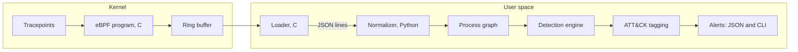

# eBPF Endpoint Detection Engine: Architecture

**Status:** design document, written before implementation.

**How to read this document:** statements marked *Observed* come from hands-on tracing with bpftrace, BCC, and a libbpf example on a WSL2 Ubuntu 24.04 system (kernel 6.6.87.2-microsoft-standard-WSL2). Statements marked *Planned* describe intended design that has not been built or tested. Statements marked *Inferred* are explanations I believe are correct but did not verify. No performance numbers appear here because none have been measured.

## 1. Purpose and scope

This project is a Linux endpoint telemetry and detection engine. It collects process activity from the kernel with eBPF, assembles that activity into a process graph, runs a small set of behavioral detections over the graph, tags each detection with a MITRE ATT&CK technique, and emits alerts as JSON and on the command line.

It follows from an earlier project, a syscall tracer built on `ptrace`. That tracer follows a single process, does not follow children created by `fork`, `vfork`, or `clone`, and stops the traced program at every system call, which makes it useful for analyzing one unknown binary but unsuitable for watching a whole machine. eBPF removes those limits by observing kernel events system-wide without stopping the processes involved.

**In scope:**

- Process lifecycle telemetry first (exec and exit), then file, network, and privilege events.
- A process graph with ancestry.
- Eight to twelve behavioral detections, chosen for depth over breadth.
- Alerts as structured JSON and command-line output.
- A measured evaluation against controlled attack simulations and a benign baseline, with failures reported honestly.

**Out of scope:**

- A dashboard or any graphical interface.
- Blocking or killing processes. The engine observes and alerts only.
- Multi-host collection or central aggregation.
- Operating systems other than Linux.

## 2. Pipeline overview

The kernel side is an eBPF program written in C that hooks tracepoints and writes compact event records into a ring buffer. A small C loader opens the compiled program, attaches it, reads the ring buffer, and prints one JSON object per line. Everything after the loader is Python, which reads those lines, normalizes them, builds the process graph, runs detections, tags them, and produces alerts.

**Design decisions and the evidence behind them:**

| Decision | Choice | Basis |
|---|---|---|
| Collection method | libbpf with CO-RE, in C | *Observed:* the `bootstrap` example from libbpf-bootstrap built and ran on this kernel with no BTF or permission errors. BCC tools also worked but compile at runtime. |
| Language split | C for the kernel program and loader, Python for everything after | Matches the project's stated stack and keeps the detection logic quick to change. |
| Stage handoff | JSON lines between the loader and the normalizer | *Observed:* the saved `events.jsonl` files of the evidence-eb-d1 to evidence-eb-d10 folders and of evidence-eb-d8-stage1 were replayed through the normalizer and the runner in the regression runs of the mapping and cleanup tasks, and two versions of the code gave the same alert streams apart from the fields that had been changed. *Planned:* the evaluation harness reuses saved runs the same way. |
| Source of parent pid and uid | Read from the kernel task structure inside the eBPF program | *Observed:* a bpftrace probe read `real_parent->tgid` and `uid` successfully using BTF, with no kernel headers installed. |
| Process-start hooks | Both the `execve` syscall entry and the successful-exec tracepoint | See section 3.1. |
| Noisy events | Capture file opens narrowly, never system-wide | *Observed:* filters in bpftrace reduce printed output but the probe still fires on every event, so a hot event costs overhead regardless of the filter. |

## 3. Telemetry layer

### 3.1 Process events (first phase)

Three kernel events cover the process lifecycle, and each shows something the others do not.

| Event | What it provides | What it misses |
|---|---|---|
| `syscalls:sys_enter_execve` | An attempt to start a program: the filename and `argv` as raw user-space pointers. Fires whether or not the exec succeeds. | No result. At this point the process name still reflects the pre-exec program. |
| `sched:sched_process_exec` | Confirmation that an exec succeeded: the final filename, `pid`, and `old_pid`. | No `argv`, no parent pid, no uid. Never fires for a failed exec. |
| `sched:sched_process_exit` | The end of a process. | Needs the exit code and signal read from the task, which the BCC `exitsnoop` tool and the libbpf `bootstrap` example both reported. |

*Observed:* running a nonexistent path produced a fork and an `execve` entry, then no successful-exec event, then an exit with code 127. A design that hooked only the successful-exec tracepoint would never see that attempt as anything but an exit with no filename, while the syscall-entry hook sees the attempted path directly.

*Planned correlation:* the attempt and the success share the same pid, so the normalizer joins them. An attempt with no matching success is a failed exec. Whether to read the syscall return value with `sys_exit_execve` instead of inferring failure from a missing success event has not been tested and is listed in section 10.

The parent pid, uid, command name, and timestamps are read inside the eBPF program from the current task and attached to each record.

### 3.2 File, network, and privilege events (later phases)

The hooks for these events have since been chosen and built (`docs/EVENT_SCHEMA.md` sections 2.5 to 2.7), and they ran in the live tests saved in the evidence-eb-d5 folder (file opens, 33 checks, 0 failed), evidence-eb-d7 (network connects, 29 checks, 0 failed), evidence-eb-d8-stage1 (the wider file filter, 75 checks, 0 failed), and evidence-eb-d9 (privilege calls, 40 checks, 0 failed). The constraint that applies now comes from the research: *Observed:* `openat` fires on every file open by every process, a single short command produced dozens of opens (shared libraries and locale files), and a plain `ls -l` opens `/etc/passwd` on its own to resolve user names. File telemetry therefore has to be narrow, and any sensitive-file detection has to use process context and not the path alone.

*Planned:* a second kernel-side list, the write-intent list, widens the file filter to persistence locations (cron directories, systemd unit directories, `/etc/ld.so.preload`, shell startup files, and the like). A path that is on that list alone is reported only when the open flags request a write, because those paths are opened read-only constantly. This is telemetry for the persistence detection in section 6, which is built, and its live test was run under sudo (the saved report in the evidence-eb-d8 folder shows 70 checks, 0 failed). The probe still fires on every open, so the extra comparisons add cost per open, and that cost has not been measured. *Observed:* the program with the wider filter was loaded by the kernel verifier and ran in the telemetry test run `20261026-150132`, saved in the evidence-eb-d8-stage1 folder (75 checks, 0 failed). In it, writes to a cron file, a systemd unit file, and shell startup files of a fake home each produced one `file_open`, and read-only opens of the write-intent paths produced none. Only the paths named in `docs/EVENT_SCHEMA.md` section 2.5 were exercised, and the added cost per open is still unmeasured. The list and the flag rule are in `docs/EVENT_SCHEMA.md` section 2.5.

### 3.3 Design principles from the research

- Prefer rare events (fork, exec, exit) over hot ones.
- Do filtering inside the kernel program where possible, because user-space filtering does not reduce the number of times the probe runs.
- Attach as few probes as the detections require.
- Send fixed-size records through the ring buffer and leave string parsing to user space.

## 4. Normalizer

The normalizer turns the loader's raw JSON lines into one consistent record per process event. Its responsibilities are joining exec attempts with their results by pid, converting the raw `argv` into a command line, attaching timestamps in a single format, and handling the cases where the loader reports incomplete data. The exact field list is defined in the event schema task and is deliberately not fixed here.

Known data-quality problems it must handle, all from the research: *Observed:* a process name read at exec entry is the old program's name, a path read at syscall entry sometimes came back empty in bpftrace, and shell aliases change the logged command line (`ls` became `ls --color=auto`). *Inferred:* the empty paths are caused by the path's memory page not yet being loaded when the probe reads it at syscall entry, which BCC's `opensnoop` did not show.

*Planned:* the normalizer is a standard-library Python program in `normalizer/`. It reads loader JSON lines from standard input or a file and writes normalized JSON lines to standard output or a file, in the same order, and prints a summary of counts and anomalies to standard error. It keys each process by pid together with start time (section 5), joins an `exec_attempt` to its `exec_success` by that key, and derives an `exec_failed` event when an attempt is followed by another attempt or an exit from the same process with no success between. It keeps every input field, adds the process key, and passes `file_open`, `net_connect`, `priv_change`, and `lost` through. *Observed:* it ran as the second stage of the live pipeline (loader, then normalizer, then runner) in the live tests of detections 1 to 10, and each of the evidence-eb-d1 to evidence-eb-d10 folders holds its summary in `normalizer.stderr` and a saved report with 0 failed checks. The field list and rules are in `docs/EVENT_SCHEMA.md` section 10.

## 5. Process graph

The graph holds processes as nodes and relationships as edges.

- **Nodes:** a process with its pid, parent pid, uid, executable path, command line, start time, and exit information.
- **Edges:** parent to child, process to file, and process to socket.
- **Queries the detections need:** the ancestry chain of a process, the children a process has spawned within a time window, and the files and sockets a process touched.

*Observed:* the chain `bash`, then `sh`, then `cat` was reconstructed correctly from parent pids in every tool, which is the basis for ancestry. Because pids are reused by the kernel, *Planned:* nodes are identified by pid together with start time and not by pid alone. Behavior under pid reuse has not been tested.

*Planned:* the graph is a standard-library Python module in `graph/`. It reads normalized JSON lines, keeps one node per process key, links each node to one parent, and answers ancestry, children, and pid-at-time queries. The parent is found from `ppid` alone, which names no start time, so the link is inferred and can be wrong under pid reuse. A parent that was never seen is a placeholder node, and the edge is marked as such. The graph has been run over constructed fixtures in unit tests and over saved events files. *Observed:* it also ran inside the runner in the live tests of detections 1 to 10 (loader, then normalizer, then runner), and the evidence-eb-d1 to evidence-eb-d10 folders show 0 detection errors in each `runner.stderr` and 0 failed checks in each saved report. The pid reuse handling has only been tested on constructed cases. The rules, bounds, and counters are in `docs/EVENT_SCHEMA.md` section 13. It contains no detections.

## 6. Detections

Ten detections are implemented, matching the roadmap, and the live test of each ran under sudo with 0 failed checks (the evidence-eb-d1 to evidence-eb-d10 folders, with the check counts in section 7; the persistence test was run again in evidence-eb-mitre, 70 checks, 0 failed). The goal is depth on each one, including how it can be evaded and what it misses, and not a long list. The technique each detection puts on its alerts is set in `detections/attack_map.py`, and the last column shows it. The mapping is a design choice, and its confidence and verification are in `docs/EVENT_SCHEMA.md` section 25.

| # | Detection | Telemetry it needs | ATT&CK |
|---|---|---|---|
| 1 | Suspicious shell spawned by a service | Process events, ancestry | T1059.004 (direct) |
| 2 | Execution from `/tmp` | Process events (executable path) | T1059 (weak) |
| 3 | Download, then chmod, then exec chain | Process events with command lines, ordering in time | T1105 (direct) |
| 4 | Unusual process ancestry | Process events, graph | T1059 (partial) |
| 5 | Sensitive file access | File events, process context | By path: T1003.008, T1552.004 (direct), T1548.003 (weak) |
| 6 | Rapid process spawning | Process events, rates over a time window | T1059 (weak) |
| 7 | Suspicious outbound connection after execution | Network events, graph | T1095 (partial) |
| 8 | Persistence behavior | File events, process context | By category or command: T1053.003, T1543.002, T1546.004, T1574.006, T1098.004, T1556.003, T1037.004 (direct), T1136.001, T1547.013 (partial), T1037 (weak) |
| 9 | Privilege escalation | Privilege events, process events | T1068 (partial) |
| 10 | Interpreter chains | Process events, ancestry | T1059 (direct) |

Detections 1 through 4, 6, and 10 depend only on process events. Detections 5, 7, 8, and 9 needed the file, network, and privilege telemetry, which now exists and ran in their live tests (evidence-eb-d5, d7, d8, and d9).

*Planned:* detection 1 is implemented as `shell_from_service` in `detections/`, with a small runner that feeds normalized events through the graph and the detections and emits alerts (section 7). It fires when a shell is executed by a process whose `comm` is on an inferred list of service names. It cannot judge a shell whose parent is a placeholder, and it will raise false alarms where a service legitimately runs a shell. Its ATT&CK technique is T1059.004 Unix Shell (direct). T1505.003 Web Shell is related and is described in the docs only (`docs/EVENT_SCHEMA.md` section 25). It has run over constructed fixtures and one saved events file, which contains no service parents. *Observed:* its live test was run under sudo, and the saved report in the evidence-eb-d1 folder shows 19 checks, 0 failed. The rule and its limits are in `docs/EVENT_SCHEMA.md` section 15.

*Planned:* detection 2 is implemented as `exec_from_tmp` in `detections/` and is registered in the same runner. It fires when a successful exec has an absolute filename under `/tmp`, `/var/tmp`, or `/dev/shm`. It reads only the filename from the exec arguments, so it cannot see an interpreter running a script from those directories, a symlink, a memfd or fd-based exec, a relative path, or a shell that changed into one of them first. Installers and build tools run programs from these directories, so false positives are expected, there is no allow list in v1, and the evaluation task is where they are measured. Its ATT&CK technique is T1059 (weak): ATT&CK has no technique for execution from a temporary directory, so the nearest label is used. The rule is in `docs/EVENT_SCHEMA.md` section 16.

*Planned:* detection 3 is implemented as `download_chmod_exec` in `detections/` and is registered in the same runner. The telemetry has no chmod event and no file-write event, so the chain is inferred from three successful execs: a `curl` or `wget` run with an output path, a `chmod` that makes that path executable, and an exec of the path, in that order and inside a time window. Relative paths are matched only inside one parent process, because the data has no working directory. Legitimate install scripts match exactly, so false positives are expected, and the evaluation task measures them. The gaps include other download tools, pipe-to-shell, an interpreter running the downloaded script, and `install -m`. Its ATT&CK technique is T1105 Ingress Tool Transfer (direct), for the download step. The rule is in `docs/EVENT_SCHEMA.md` section 17.

*Planned:* detection 4 is implemented as `unusual_ancestry` in `detections/` and is registered in the same runner. It is a rule-based detection and not a learned baseline: it fires when a shell, an interpreter, or a network tool is executed anywhere below a process whose `comm` is on the service-name list of detection 1, using the graph's ancestry chain. A shell that is the direct child of the service is left to detection 1. A chain that is cut by a placeholder or a depth cap cannot be judged and is counted. The rule is name-based, so it is narrower than the word "unusual", and services that legitimately run interpreters will raise false positives that the evaluation task measures. Its ATT&CK technique is T1059 (partial). T1505.003 Web Shell is related and is described in the docs only. The rule is in `docs/EVENT_SCHEMA.md` section 18.

*Planned:* detection 5 is implemented as `sensitive_file_access` in `detections/` and is registered in the same runner. It reads the `file_open` events that the kernel filter lets through and alerts on a successful open (the event carries the return value in the default loader mode). Opens of the shadow, sudoers, and private SSH key files alert unless the program is on an expected-reader list, which is a name list and so is bypassed by a renamed binary. An open of `/etc/passwd` alerts only when the reader runs below a service-named process. Failed opens, opens with no return value, and chains that cannot be judged are counted and do not alert. Legitimate administration and probing for missing keys are gaps, and false positives are expected and measured by the evaluation task. Its ATT&CK technique depends on the path: T1003.008 for the shadow and passwd files, T1552.004 for private keys (both direct), and T1548.003 for the sudoers files (weak). The rule is in `docs/EVENT_SCHEMA.md` section 19.

*Planned:* detection 6 is implemented as `rapid_spawn` in `detections/` and is registered in the same runner. It counts the distinct children that start a program under one parent, using the parent node from the graph, and alerts once when 25 or more of them fall inside a 2 second sliding window; it is armed again when the count has dropped. The threshold and the window are first guesses that have not been measured. Processes that fork without exec are invisible, because the telemetry has no fork hook, and a fork bomb across many parents is not grouped. Legitimate builds, installers, shell loops, and package managers will alert, and the evaluation task measures those false positives. Its ATT&CK technique is T1059 (weak): the rule detects scripted bulk execution, which ATT&CK does not name. The rule is in `docs/EVENT_SCHEMA.md` section 20.

*Planned:* detection 7 is implemented as `outbound_after_exec` in `detections/` and is registered in the same runner. It alerts on a `net_connect` to a non-loopback address by a process that looks suspect (an executable under `/tmp`, `/var/tmp`, or `/dev/shm`, or a shell, interpreter, or network tool by name) when the connect comes within 60 seconds of that process's latest successful exec, once per process, address, and port. The telemetry records the connect attempt only, so a refused connection looks like a success. It has no DNS names, and it does not see UDP traffic that does not use `connect`. Processes that started before the loader cannot be judged. Private ranges are included by default on purpose. A legitimate script that connects soon after it starts will alert, and the evaluation task measures those false positives. Its ATT&CK technique is T1095 Non-Application Layer Protocol (partial), because the telemetry cannot see the protocol. The rule is in `docs/EVENT_SCHEMA.md` section 21.

*Planned:* detection 8 is implemented as `persistence` in `detections/` and is registered in the same runner. One function raises `persistence_write` for a write-flagged open of a persistence location (cron, systemd units, `/etc/ld.so.preload`, shell startup files, PAM, authorized keys, and the like, in eleven categories) and `persistence_command` for an exec of `crontab` that installs a table or of `systemctl` with `enable`, `reenable`, or `link`. The exec case exists because `crontab` and `systemctl enable` work through `rename` and `symlink`, which the file hook cannot see. The detection checks the open flags and the return value itself, skips a list of expected writers by `comm` (so a renamed binary is suppressed), and raises one alert per process and path. Rename, link, symlink, `creat`, `openat2`, writes through a held descriptor, and relative paths are invisible, and many persistence methods are out of scope. Legitimate administration alerts, and the evaluation task measures those false positives. Its ATT&CK technique depends on the category of the path or on the command, from T1053.003 Cron to T1037 Boot or Logon Initialization Scripts, with the table and the approximations in `docs/EVENT_SCHEMA.md` section 25. The rule is in `docs/EVENT_SCHEMA.md` section 22. It has run over constructed fixtures and saved events files. *Observed:* its live test was run under sudo, and the saved report in the evidence-eb-d8 folder shows 70 checks, 0 failed.

*Planned:* detection 9 is implemented as `privilege_escalation` in `detections/` and is registered in the same runner. It has two signals. The request signal alerts on a `setuid`, `setreuid`, or `setresuid` event that asks for uid 0 from a process whose uid is not 0, unless the process name is on an editable list of expected escalators such as `sudo` and `su`. The change signal alerts on a process that is seen at uid 0 after an earlier event at another uid when no hooked request for 0 explains it, which is the shape of a kernel exploit. The telemetry records the request at syscall entry with no result, so a denied request alerts like a granted one. *Inferred* from the code: the uid in every event is the real uid, so a setuid binary or sudo's effective uid is invisible. Group ids, capabilities, `fsuid`, and direct kernel credential changes are not covered, a renamed binary is suppressed because the list is name based, and a legitimate setuid helper that is not on the list will alert. The evaluation task measures those false positives. Its ATT&CK technique is T1068 Exploitation for Privilege Escalation (partial), because the request signal cannot tell a granted request from a denied one. The rule is in `docs/EVENT_SCHEMA.md` section 23. It has run over constructed fixtures and saved events files, where it raised no alert. *Observed:* its live test was run under sudo, and the saved report in the evidence-eb-d9 folder shows 40 checks, 0 failed.

*Planned:* detection 10 is implemented as `interpreter_chain` in `detections/` and is registered in the same runner as the tenth and last entry. For an exec of a shell or an interpreter it walks up the graph's ancestry while each ancestor's latest successful exec is also a shell or an interpreter, and it alerts when that run holds at least three processes of at least two kinds (shell, python, perl, ruby, php, node) and at least one of them was started with an inline-code option such as `-c`. The three limits are first guesses that have not been measured. A renamed interpreter is invisible, a program that is not watched (`make`, an editor, `ls`) ends the run, the command lines of ancestors are joined text and are read less exactly than the exec that fired the rule, and a process that started before the loader hides the chain behind it. Build scripts, package managers, and test runners that call python from sh from python will alert, and the evaluation task measures those false positives. Its ATT&CK technique is T1059 (direct). The rule is in `docs/EVENT_SCHEMA.md` section 24. It has run over constructed fixtures and saved events files, where it raised no alert. *Observed:* its live test was run under sudo, and the saved report in the evidence-eb-d10 folder shows 52 checks, 0 failed, with the two alerts expected in case a.

## 7. Alerts

Each alert is a JSON object carrying the detection name, the ATT&CK technique, a timestamp, the triggering process, its ancestry, and the evidence that fired the rule, and the same information is rendered as readable lines on the command line. The exact format is *Planned* and is finalized alongside the event schema.

*Planned:* the output layer is a standard-library Python module in `alerts/`. Detections will call a builder that copies the triggering process, its ancestry from the graph, and the evidence events into a plain dict, and a sink that writes it as one JSON line and as readable lines on a second stream. The technique field holds the id from the mapping of section 6, and `ts_ns` is the kernel monotonic value because the wall-clock conversion is still open. The module has been run over constructed fixtures and one saved events file with a test-only trigger. *Observed:* the detections of section 6 also used it in live pipeline runs, and the saved reports of the evidence-eb-d1 to evidence-eb-d10 folders (19, 26, 32, 24, 33, 23, 29, 70, 40, and 52 checks, 0 failed in each) pass the checks that every alert line is valid JSON with every required field, a technique that was null in those runs (they came before the mapping), and a sequence number that counts from 1. The field list and rules are in `docs/EVENT_SCHEMA.md` section 14.

## 8. Evaluation plan

Evaluation is a required part of the project. The plan is to run twenty to thirty controlled attack simulations and a benign workload baseline, and to report the following, whether or not the results are flattering:

- Precision and recall.
- True positives and false negatives per technique.
- Median and 95th percentile detection latency.
- CPU and memory use.
- Events per second.
- False positives per hour on the benign baseline.

Because the loader emits JSON lines, an evaluation run can be recorded once and replayed through the normalizer and detections, which keeps measurements repeatable. Misses and failures get their own section in the final writeup.

*Planned:* the harness is built in `evaluation/` and described in `docs/EVENT_SCHEMA.md` section 26. A driver run with sudo starts the same pipeline as the live tests, runs scenarios one at a time (each a labeled attack or a benign activity with a unique marker in its command line), stamps every alert with its arrival time, samples CPU and memory, reads the per-program `bpf_stats`, and saves everything in a results folder. An offline scorer then attributes alerts to scenarios and computes the counts, ratios, latency percentiles, and false positives per hour, and writes a report. What exists is the machinery, a five-scenario smoke set, and 24 more attack scenarios (28 attack scenarios in all, in an ordinary group written by the person who read the rules and a gap group built to miss). The report shows the two groups as separate headline tables, lists scenarios that were not run, and sets the predictions written before any run against the actual outcomes. *Observed:* the smoke set was run under sudo against the live pipeline, and the saved reports (the evidence-eb-e1-run1 and evidence-eb-e1-bpfstats folders) show S01 and S03 detected, S02 and S04 missed, and S05 clean in both, as predicted. The 24 added scenarios have not been run: their scripts were exercised only against scratch directories, and their predictions are in `evaluation/predictions.json` (`docs/EVENT_SCHEMA.md` section 27). The full benign baseline and the final measurements are later tasks and are not built. The design measures precision and recall per scenario, with a count next to every ratio, and 28 attack scenarios are a demonstration and not a statistical estimate. *No evaluation results beyond the smoke runs exist yet.*

## 9. Observed constraints

| Finding | Status |
|---|---|
| All tracing needs root, because tracefs is root-only | Observed |
| No kernel headers are installed on the stock WSL2 kernel, yet bpftrace struct access, BCC tools, and the libbpf example all worked | Observed |
| Kernel config has BPF, JIT, BPF events, BPF LSM, syscall tracing, and BTF enabled | Observed |
| `sched_process_exec` fires only for successful execs | Observed |
| Process name at exec entry is the pre-exec name | Observed |
| A failed exec shows up as an exit with code 127 and no filename when only exec and exit are watched | Observed |
| Empty paths at `openat` entry in bpftrace | Observed, cause inferred |
| Building the libbpf example needs `clang`, `llvm`, `libelf-dev`, `zlib1g-dev`, and `libssl-dev` | Observed |
| Behavior on non-WSL2 kernels | Not tested |

## 10. Open questions

- Whether to read the `execve` return value with `sys_exit_execve` or infer failure from a missing success event.
- How many bytes of `argv` and how many arguments to capture, and what to do when they are truncated. `envp` is available at the same hook but capturing it has not been considered.
- How to key nodes safely under pid reuse.
- Whether a `fork` hook is needed at all, given that the parent pid can be read from the task.
- Which hook points to use for network and privilege events. *Observed:* settled as `sys_enter_connect` and the five uid and gid syscalls (`docs/EVENT_SCHEMA.md` sections 2.6 and 2.7), which ran in the live tests saved in evidence-eb-d7 (29 checks, 0 failed) and evidence-eb-d9 (40 checks, 0 failed).
- Whether to capture file paths at syscall entry or at exit, given the empty paths seen at entry.
- Ring buffer sizing and what happens to events when the consumer falls behind.
- Coverage of `execveat`, which is a separate tracepoint and was not tested.
- Behavior inside containers and other namespaces.
- Portability across kernel versions beyond the one used for this research.
