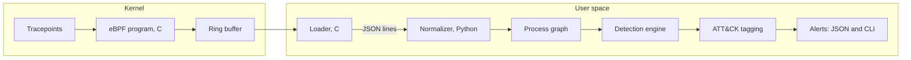

# eBPF Endpoint Detection Engine: Architecture

**Status:** design document, written before implementation.

**How to read this document:** statements marked *Observed* come from hands-on tracing with bpftrace, BCC, and a libbpf example on a WSL2 Ubuntu 24.04 system (kernel 6.6.87.2-microsoft-standard-WSL2). Statements marked *Planned* describe intended design that has not been built or tested. Statements marked *Inferred* are explanations I believe are correct but did not verify. No performance numbers appear here because none have been measured.

## 1. Purpose and scope

This project is a Linux endpoint telemetry and detection engine. It collects process activity from the kernel with eBPF, assembles that activity into a process graph, runs a small set of behavioral detections over the graph, tags each detection with a MITRE ATT&CK technique, and emits alerts as JSON and on the command line.

It follows from an earlier project, a syscall tracer built on `ptrace`. That tracer follows a single process, does not follow children created by `fork`, `vfork`, or `clone`, and stops the traced program at every system call, which makes it useful for analyzing one unknown binary but unsuitable for watching a whole machine. eBPF removes those limits by observing kernel events system-wide without stopping the processes involved.

**In scope:**

- Process lifecycle telemetry first (exec and exit), then file, network, and privilege events.
- A process graph with ancestry.
- Eight to twelve behavioral detections, chosen for depth over breadth.
- Alerts as structured JSON and command-line output.
- A measured evaluation against controlled attack simulations and a benign baseline, with failures reported honestly.

**Out of scope:**

- A dashboard or any graphical interface.
- Blocking or killing processes. The engine observes and alerts only.
- Multi-host collection or central aggregation.
- Operating systems other than Linux.

## 2. Pipeline overview

The kernel side is an eBPF program written in C that hooks tracepoints and writes compact event records into a ring buffer. A small C loader opens the compiled program, attaches it, reads the ring buffer, and prints one JSON object per line. Everything after the loader is Python, which reads those lines, normalizes them, builds the process graph, runs detections, tags them, and produces alerts.

**Design decisions and the evidence behind them:**

| Decision | Choice | Basis |
|---|---|---|
| Collection method | libbpf with CO-RE, in C | *Observed:* the `bootstrap` example from libbpf-bootstrap built and ran on this kernel with no BTF or permission errors. BCC tools also worked but compile at runtime. |
| Language split | C for the kernel program and loader, Python for everything after | Matches the project's stated stack and keeps the detection logic quick to change. |
| Stage handoff | JSON lines between the loader and the normalizer | *Planned:* recorded event files can be replayed into the normalizer, which lets each stage be tested on its own and lets the evaluation harness reuse saved runs. |
| Source of parent pid and uid | Read from the kernel task structure inside the eBPF program | *Observed:* a bpftrace probe read `real_parent->tgid` and `uid` successfully using BTF, with no kernel headers installed. |
| Process-start hooks | Both the `execve` syscall entry and the successful-exec tracepoint | See section 3.1. |
| Noisy events | Capture file opens narrowly, never system-wide | *Observed:* filters in bpftrace reduce printed output but the probe still fires on every event, so a hot event costs overhead regardless of the filter. |

## 3. Telemetry layer

### 3.1 Process events (first phase)

Three kernel events cover the process lifecycle, and each shows something the others do not.

| Event | What it provides | What it misses |
|---|---|---|
| `syscalls:sys_enter_execve` | An attempt to start a program: the filename and `argv` as raw user-space pointers. Fires whether or not the exec succeeds. | No result. At this point the process name still reflects the pre-exec program. |
| `sched:sched_process_exec` | Confirmation that an exec succeeded: the final filename, `pid`, and `old_pid`. | No `argv`, no parent pid, no uid. Never fires for a failed exec. |
| `sched:sched_process_exit` | The end of a process. | Needs the exit code and signal read from the task, which the BCC `exitsnoop` tool and the libbpf `bootstrap` example both reported. |

*Observed:* running a nonexistent path produced a fork and an `execve` entry, then no successful-exec event, then an exit with code 127. A design that hooked only the successful-exec tracepoint would never see that attempt as anything but an exit with no filename, while the syscall-entry hook sees the attempted path directly.

*Planned correlation:* the attempt and the success share the same pid, so the normalizer joins them. An attempt with no matching success is a failed exec. Whether to read the syscall return value with `sys_exit_execve` instead of inferring failure from a missing success event has not been tested and is listed in section 10.

The parent pid, uid, command name, and timestamps are read inside the eBPF program from the current task and attached to each record.

### 3.2 File, network, and privilege events (later phases)

These are not yet explored and the hook points will be chosen when each is implemented. The constraint that applies now comes from the research: *Observed:* `openat` fires on every file open by every process, a single short command produced dozens of opens (shared libraries and locale files), and a plain `ls -l` opens `/etc/passwd` on its own to resolve user names. File telemetry therefore has to be narrow, and any sensitive-file detection has to use process context and not the path alone.

### 3.3 Design principles from the research

- Prefer rare events (fork, exec, exit) over hot ones.
- Do filtering inside the kernel program where possible, because user-space filtering does not reduce the number of times the probe runs.
- Attach as few probes as the detections require.
- Send fixed-size records through the ring buffer and leave string parsing to user space.

## 4. Normalizer

The normalizer turns the loader's raw JSON lines into one consistent record per process event. Its responsibilities are joining exec attempts with their results by pid, converting the raw `argv` into a command line, attaching timestamps in a single format, and handling the cases where the loader reports incomplete data. The exact field list is defined in the event schema task and is deliberately not fixed here.

Known data-quality problems it must handle, all from the research: *Observed:* a process name read at exec entry is the old program's name, a path read at syscall entry sometimes came back empty in bpftrace, and shell aliases change the logged command line (`ls` became `ls --color=auto`). *Inferred:* the empty paths are caused by the path's memory page not yet being loaded when the probe reads it at syscall entry, which BCC's `opensnoop` did not show.

*Planned:* the normalizer is a standard-library Python program in `normalizer/`. It reads loader JSON lines from standard input or a file and writes normalized JSON lines to standard output or a file, in the same order, and prints a summary of counts and anomalies to standard error. It keys each process by pid together with start time (section 5), joins an `exec_attempt` to its `exec_success` by that key, and derives an `exec_failed` event when an attempt is followed by another attempt or an exit from the same process with no success between. It keeps every input field, adds the process key, and passes `file_open`, `net_connect`, `priv_change`, and `lost` through. It has not been run as part of a recorded pipeline. The field list and rules are in `docs/EVENT_SCHEMA.md` section 10.

## 5. Process graph

The graph holds processes as nodes and relationships as edges.

- **Nodes:** a process with its pid, parent pid, uid, executable path, command line, start time, and exit information.
- **Edges:** parent to child, process to file, and process to socket.
- **Queries the detections need:** the ancestry chain of a process, the children a process has spawned within a time window, and the files and sockets a process touched.

*Observed:* the chain `bash`, then `sh`, then `cat` was reconstructed correctly from parent pids in every tool, which is the basis for ancestry. Because pids are reused by the kernel, *Planned:* nodes are identified by pid together with start time and not by pid alone. Behavior under pid reuse has not been tested.

*Planned:* the graph is a standard-library Python module in `graph/`. It reads normalized JSON lines, keeps one node per process key, links each node to one parent, and answers ancestry, children, and pid-at-time queries. The parent is found from `ppid` alone, which names no start time, so the link is inferred and can be wrong under pid reuse. A parent that was never seen is a placeholder node, and the edge is marked as such. The graph has been run over constructed fixtures in unit tests and over one saved events file, not over a live pipeline, and the pid reuse handling has only been tested on constructed cases. The rules, bounds, and counters are in `docs/EVENT_SCHEMA.md` section 13. It contains no detections.

## 6. Detections

Ten detections are planned, matching the roadmap. The goal is depth on each one, including how it can be evaded and what it misses, and not a long list. ATT&CK technique mappings are assigned in the dedicated mapping task and are intentionally left blank here.

| # | Detection | Telemetry it needs | ATT&CK |
|---|---|---|---|
| 1 | Suspicious shell spawned by a service | Process events, ancestry | To be assigned |
| 2 | Execution from `/tmp` | Process events (executable path) | To be assigned |
| 3 | Download, then chmod, then exec chain | Process events with command lines, ordering in time | To be assigned |
| 4 | Unusual process ancestry | Process events, graph | To be assigned |
| 5 | Sensitive file access | File events, process context | To be assigned |
| 6 | Rapid process spawning | Process events, rates over a time window | To be assigned |
| 7 | Suspicious outbound connection after execution | Network events, graph | To be assigned |
| 8 | Persistence behavior | File events, process context | To be assigned |
| 9 | Privilege escalation | Privilege events, process events | To be assigned |
| 10 | Interpreter chains | Process events, ancestry | To be assigned |

Detections 1 through 4, 6, and 10 depend only on process events, so they can be built in the first telemetry phase. Detections 5, 7, 8, and 9 wait on the later telemetry.

*Planned:* detection 1 is implemented as `shell_from_service` in `detections/`, with a small runner that feeds normalized events through the graph and the detections and emits alerts (section 7). It fires when a shell is executed by a process whose `comm` is on an inferred list of service names. It cannot judge a shell whose parent is a placeholder, and it will raise false alarms where a service legitimately runs a shell. Its ATT&CK technique is left null until the mapping task. It has run over constructed fixtures and one saved events file, which contains no service parents, and a live test script exists and has not been run. The rule and its limits are in `docs/EVENT_SCHEMA.md` section 15.

*Planned:* detection 2 is implemented as `exec_from_tmp` in `detections/` and is registered in the same runner. It fires when a successful exec has an absolute filename under `/tmp`, `/var/tmp`, or `/dev/shm`. It reads only the filename from the exec arguments, so it cannot see an interpreter running a script from those directories, a symlink, a memfd or fd-based exec, a relative path, or a shell that changed into one of them first. Installers and build tools run programs from these directories, so false positives are expected, there is no allow list in v1, and the evaluation task is where they are measured. Its ATT&CK technique is left null until the mapping task. The rule is in `docs/EVENT_SCHEMA.md` section 16.

## 7. Alerts

Each alert is a JSON object carrying the detection name, the ATT&CK technique, a timestamp, the triggering process, its ancestry, and the evidence that fired the rule, and the same information is rendered as readable lines on the command line. The exact format is *Planned* and is finalized alongside the event schema.

*Planned:* the output layer is a standard-library Python module in `alerts/`. Detections will call a builder that copies the triggering process, its ancestry from the graph, and the evidence events into a plain dict, and a sink that writes it as one JSON line and as readable lines on a second stream. The technique field is null until the ATT&CK mapping task assigns techniques (section 6), and `ts_ns` is the kernel monotonic value because the wall-clock conversion is still open. The module has been run over constructed fixtures and one saved events file with a test-only trigger, not with any detection. The field list and rules are in `docs/EVENT_SCHEMA.md` section 14.

## 8. Evaluation plan

Evaluation is a required part of the project. The plan is to run twenty to thirty controlled attack simulations and a benign workload baseline, and to report the following, whether or not the results are flattering:

- Precision and recall.
- True positives and false negatives per technique.
- Median and 95th percentile detection latency.
- CPU and memory use.
- Events per second.
- False positives per hour on the benign baseline.

Because the loader emits JSON lines, an evaluation run can be recorded once and replayed through the normalizer and detections, which keeps measurements repeatable. Misses and failures get their own section in the final writeup. *No results exist yet.*

## 9. Observed constraints

| Finding | Status |
|---|---|
| All tracing needs root, because tracefs is root-only | Observed |
| No kernel headers are installed on the stock WSL2 kernel, yet bpftrace struct access, BCC tools, and the libbpf example all worked | Observed |
| Kernel config has BPF, JIT, BPF events, BPF LSM, syscall tracing, and BTF enabled | Observed |
| `sched_process_exec` fires only for successful execs | Observed |
| Process name at exec entry is the pre-exec name | Observed |
| A failed exec shows up as an exit with code 127 and no filename when only exec and exit are watched | Observed |
| Empty paths at `openat` entry in bpftrace | Observed, cause inferred |
| Building the libbpf example needs `clang`, `llvm`, `libelf-dev`, `zlib1g-dev`, and `libssl-dev` | Observed |
| Behavior on non-WSL2 kernels | Not tested |

## 10. Open questions

- Whether to read the `execve` return value with `sys_exit_execve` or infer failure from a missing success event.
- How many bytes of `argv` and how many arguments to capture, and what to do when they are truncated. `envp` is available at the same hook but capturing it has not been considered.
- How to key nodes safely under pid reuse.
- Whether a `fork` hook is needed at all, given that the parent pid can be read from the task.
- Which hook points to use for network and privilege events.
- Whether to capture file paths at syscall entry or at exit, given the empty paths seen at entry.
- Ring buffer sizing and what happens to events when the consumer falls behind.
- Coverage of `execveat`, which is a separate tracepoint and was not tested.
- Behavior inside containers and other namespaces.
- Portability across kernel versions beyond the one used for this research.
